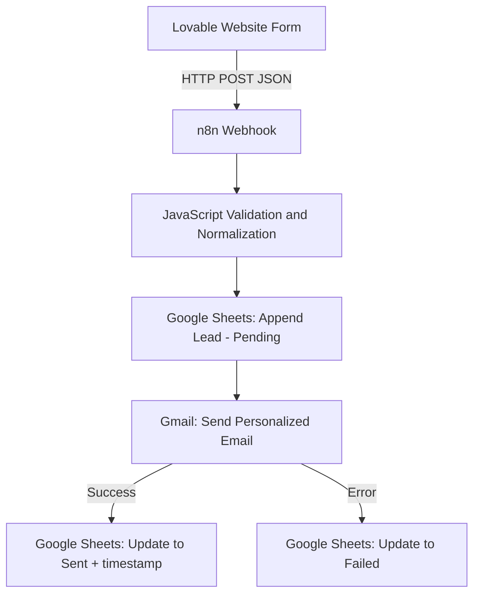

# Lead Management Automation

A lead-capture and follow-up automation system built with **Lovable**,
**n8n**, **Google Sheets**, and **Gmail**.

Visitors submit an enquiry through the website. The n8n workflow
validates and normalizes the submitted data, stores the lead in Google
Sheets, sends a personalized acknowledgement email, and updates the
email status to `Sent` or `Failed`.

## Live Demo

**Website:** [Aminul AI
Cloud](https://pixel-perfect-replay-5212.lovable.app)

## Project Screenshots

### 1. Website Contact Form


### 2. n8n Workflow Architecture


### 3. Successful Workflow Execution


### 4. Personalized Email


### 5. Google Sheets Lead Status


*Personal identifiers are obscured in the public evidence screenshot.*

## Features

-   Website contact form with Name, Email, Company Name, Interested
    Service, and Message.
-   HTTP POST integration from the website to an n8n webhook.
-   Required-field validation and basic email-format validation.
-   Normalization of `companyName` / `company_name` and
    `interestedService` / `interested_service`.
-   Unique Lead ID generation.
-   Submission timestamp using the `Asia/Dhaka` timezone.
-   Google Sheets lead storage.
-   Personalized Gmail acknowledgement.
-   Separate success and failure branches for email-status tracking.

## Technology Stack

  Layer                                Technology
  ------------------------------------ -------------------
  Website and form                     Lovable
  Workflow automation                  n8n
  Lead storage                         Google Sheets
  Email delivery                       Gmail
  Data validation and transformation   JavaScript
  Integration                          HTTP POST webhook

## Workflow Architecture



## Workflow Steps

1.  **Webhook** receives the website form submission.
2.  **Code in JavaScript** validates required fields, normalizes field
    names, validates the email format, generates a Lead ID, and prepares
    the lead record.
3.  **Append row in sheet** stores the lead with
    `Email_Status = Pending`.
4.  **Send a message** sends a personalized acknowledgement through
    Gmail.
5.  **Update row in sheet** matches the lead by `Lead_ID`, sets
    `Email_Status = Sent`, and records `Email_Sent_At`.
6.  **Update Lead Status - Failed** matches the lead by `Lead_ID` and
    sets `Email_Status = Failed` when the Gmail node returns an error.

## Google Sheets Columns

  Column                 Purpose
  ---------------------- ------------------------------------------------
  `Lead_ID`              Generated lead identifier
  `Name`                 Contact name
  `Email`                Contact email
  `Company_Name`         Company or organization
  `Interested_Service`   Selected service
  `Message`              Enquiry message
  `Submission_Date`      Submission timestamp in Asia/Dhaka
  `Email_Status`         `Pending`, `Sent`, or `Failed`
  `Email_Sent_At`        Timestamp recorded after successful Gmail send

## Example Form Payload

The following is fictional sample data for documentation:

``` json
{
  "name": "Jane Doe",
  "email": "jane@example.com",
  "companyName": "Example Company",
  "interestedService": "AI Automation",
  "message": "I would like to learn more about your services."
}
```

The workflow also accepts `company_name` and `interested_service` as
alternate field names.

## Test Results

The workflow was tested with website form submissions.

  -----------------------------------------------------------------------
  Test                    Expected result         Observed result
  ----------------------- ----------------------- -----------------------
  Valid lead submission   Lead is stored in       Passed
                          Google Sheets           

  Successful email send   Status changes to       Passed
                          `Sent` and timestamp is 
                          recorded                

  Gmail send failure      Status changes to       Passed
                          `Failed`                

  Personalized email      Name and selected       Passed
                          service appear in email 
  -----------------------------------------------------------------------

**Status note:** `Sent` means the Gmail send operation completed
successfully. It does not prove that the recipient opened the email or
that a later bounce/spam event did not occur. The current failure branch
handles errors returned by the Gmail node, not later delivery
notifications.

## Setup

### Prerequisites

-   A Lovable project containing the lead form.
-   An n8n instance.
-   A Google account with access to a target spreadsheet.
-   A Gmail account authorized for sending email.

### Import the workflow

1.  Download `Lead Management Automation.json` from this repository.
2.  Import it into n8n.
3.  Connect your own Google Sheets OAuth2 credential to each Google
    Sheets node.
4.  Replace `REPLACE_WITH_YOUR_GOOGLE_SHEET_ID` in all three Google
    Sheets nodes with your own spreadsheet ID.
5.  Confirm the worksheet name is `Leads` and the columns match the
    structure above.
6.  Connect your own Gmail OAuth2 credential to the Gmail node.
7.  Verify the Gmail recipient uses the validated lead's `Email` field
    dynamically.
8.  Configure the webhook for your deployment and update the website
    form endpoint accordingly.
9.  Test both success and failure paths before activating the workflow.

The public workflow export intentionally omits credential bindings and
deployment-specific identifiers. You must configure your own
credentials, spreadsheet ID, and webhook deployment after import.

## Security and Privacy

This repository is a demonstration project. Before using the workflow
with real customer data:

-   Add CAPTCHA or equivalent bot protection to the public form.
-   Add rate limiting and abuse monitoring.
-   Protect the webhook against unauthorized or abusive requests. Do not
    place a shared secret in browser-side JavaScript.
-   Enforce field-length limits and validate incoming data server-side.
-   Escape user-controlled values before inserting them into HTML email
    content to prevent HTML injection.
-   Keep the Google Sheet restricted to authorized users.
-   Never commit OAuth tokens, API keys, passwords, private spreadsheet
    links, or real customer records.
-   Review screenshots and exported workflow JSON before publishing. The
    included Google Sheets screenshot has personal identifiers obscured.
-   Add duplicate-lead detection and operational monitoring for
    production use.

## Repository Contents

``` text
.
├── README.md
├── Lead Management Automation.json
└── screenshots/
    ├── 01-website-contact-form.png
    ├── 02-successful-workflow-execution.png
    ├── 03-workflow-architecture.png
    ├── 04-personalized-email.png
    └── 05-google-sheets-status-redacted.png
```

## Author

**Aminul Islam**\
Software Developer \| Oracle APEX \| Database Development \| AI
Automation
